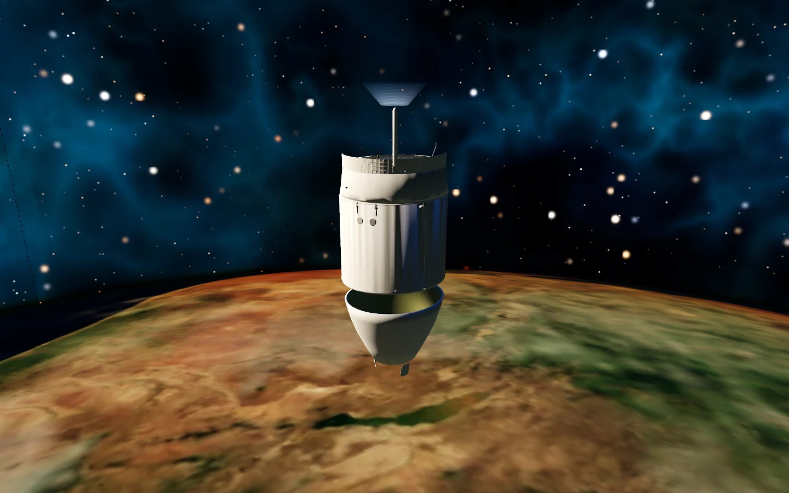
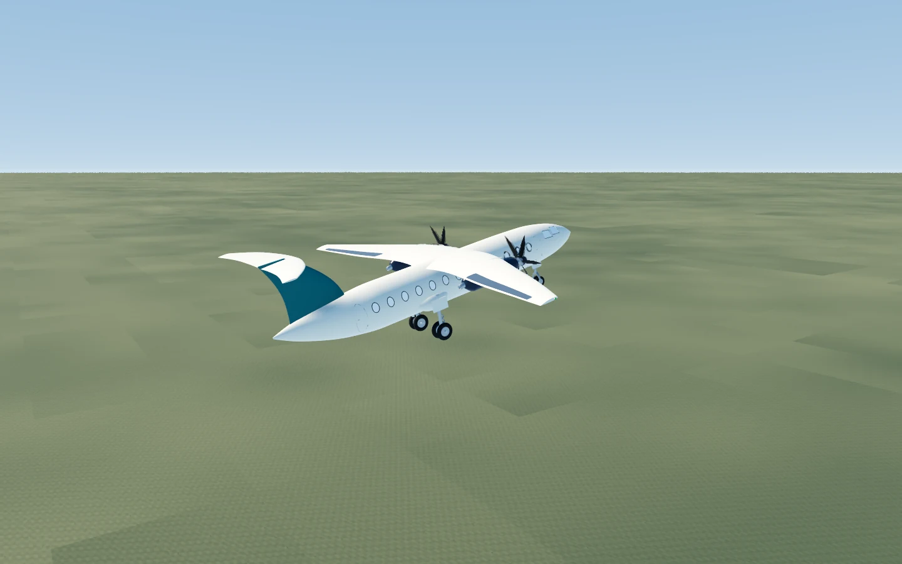
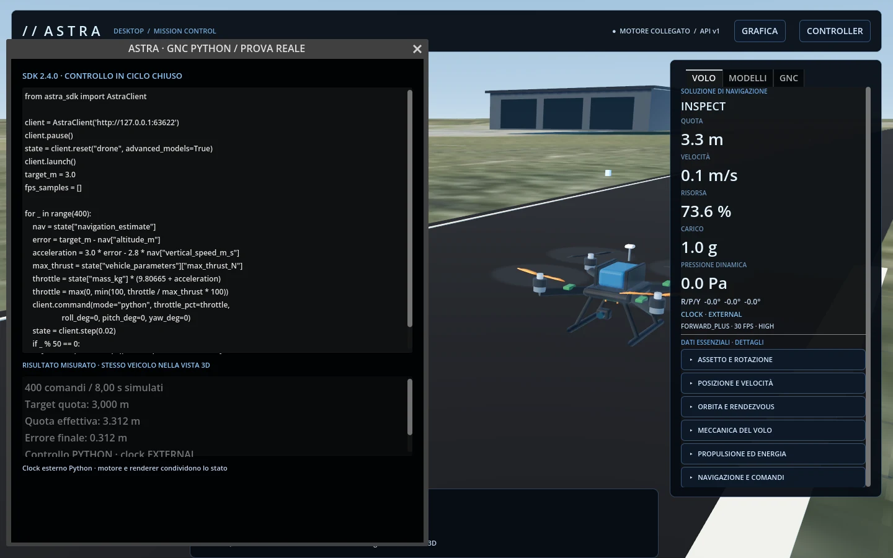

# ASTRA Desktop

Simulatore aerospaziale **nativo per Windows 11 x64**, utilizzabile offline. Motore scientifico Python, grafica 3D Godot, tastiera, controller e API per controllare la stessa simulazione da script.

**Desktop 2.4.0 · SDK Python 2.4.0 · release Windows x64.**

[Scarica l’installer Windows](https://github.com/Eleman07/ASTRA-Aerospace-Simulator/releases/download/v2.4.0-desktop/ASTRA-Desktop-2.4.0-Windows-x64-Setup.exe) · [Scarica il wheel Python](https://github.com/Eleman07/ASTRA-Aerospace-Simulator/releases/download/v2.4.0-desktop/astra_simulator_client-2.4.0-py3-none-any.whl) · [Note della release](https://github.com/Eleman07/ASTRA-Aerospace-Simulator/releases/tag/v2.4.0-desktop)



## Trailer cinematografico

[Trailer 4K](https://github.com/Eleman07/ASTRA-Aerospace-Simulator/releases/download/v2.3.2-desktop/ASTRA_Cinematic_Trailer_4K.mp4) · [Trailer 1080p](https://github.com/Eleman07/ASTRA-Aerospace-Simulator/releases/download/v2.3.2-desktop/ASTRA_Cinematic_Trailer_1080p.mp4) · [Crediti completi del trailer](https://github.com/Eleman07/ASTRA-Aerospace-Simulator/releases/download/v2.3.2-desktop/ASTRA-Trailer-Credits.txt)

55 secondi, **3840×2160, 16:9, 30 fps**. Scene reali nel motore ASTRA: Falcon 9 nello spazio, aereo, UAV, controllo tramite SDK Python e modalità GIOCA. Titoli inglesi, movimenti di camera, transizioni e color grading; solo musica. Finale con il portfolio [elemanprojects.com](https://elemanprojects.com).

Musica: **“Horizons” di Scott Buckley**, pubblicata in [CC BY 4.0](https://creativecommons.org/licenses/by/4.0/), [scottbuckley.com.au](https://www.scottbuckley.com.au/library/horizons/). Estratto montato con dissolvenze e normalizzazione del volume. Autori e licenze dei modelli sono nei crediti allegati.

## Installare e avviare

1. Scarica `ASTRA-Desktop-2.4.0-Windows-x64-Setup.exe` dagli asset della release.
2. Chiudi eventuali istanze precedenti di ASTRA e avvia l’installer.
3. Apri **ASTRA Desktop** dal menu Start. Il simulatore include motore, modelli, texture e audio: non richiede Internet, browser o Python installato.
4. Usa il profilo principale su GPU Vulkan; se necessario scegli **Grafica leggera** per il backend OpenGL. Aggiorna il driver della GPU se il renderer non si avvia.

L’installer è per Windows x64 e non è firmato digitalmente. Il wheel serve solo a chi vuole scrivere script Python.

## Primo volo

Nel menu **OPERAZIONI DI VOLO** seleziona **SIMULATORE** per le procedure tecniche o **GIOCA** per entrare nella carriera. Le missioni tecniche del Simulatore restano disponibili come prima; Gioca mostra tre sole discipline:

| Esperienza | Partenza e comportamento |
|---|---|
| Spazio · lancio e recupero | Razzo sulla rampa, lancio e recupero secondo il profilo ASTRA. |
| Spazio · rendezvous LEO | Veicolo in orbita con guida di rendezvous e bersaglio ISS. |
| Luna · discesa | Lander con dinamica locale a sei gradi di libertà. |
| Aereo · decollo e circuito | Partenza dalla pista e circuito automatico. |
| UAV · ispezione e rientro | Decollo, ispezione e rientro del multirotore. |
| Gioca · Spazio | Campagna Frontier Blu: lancio, rendezvous, aggancio orbitale e tre operazioni lunari. |
| Gioca · Aereo | Circuito completo, rotta in quota e rientro stretto. |
| Gioca · Drone | Ispezione della rete, diagnosi strutturale e campionamento atmosferico. |

Scegli una delle sole tre discipline per aprire la bacheca, leggi il briefing di controllo missione, gli obiettivi e le ricompense. Le 12 operazioni sono divise in tre campagne tecniche per categoria: ingegneria, esplorazione, pilotaggio e scienza; ogni campagna verifica i dati reali del volo. La progressione sblocca le missioni in sequenza; crediti, reputazione, scienza, tecnologie e strutture vengono salvati localmente. Quota, distanza, mantenimento della quota, rendezvous e touchdown sono misurati dal motore, non da timer fittizi. In Gioca la tastiera è attiva all'avvio; i controller si armano dal pannello **CONTROLLER**. Carburante, batteria, stallo e urti restano attivi.



## Tastiera, controller e camera

Seleziona **CONTROLLO DA TASTIERA** per pilotare. Per Xbox/gamepad apri **CONTROLLER**, seleziona il dispositivo, rilascia gli stick ed esegui l’armamento esplicito. I profili di calibrazione sono separati per categoria di veicolo.

**Gli stick controllano il volo; la croce direzionale controlla i menu.** Gli assi analogici non cambiano focus, missione o valori nei pannelli. Assegna Xbox soltanto a **Primario**: manetta e pedali separati richiedono dispositivi distinti. Il profilo **RISPOSTA PRONTA** offre sensibilità e velocità della manetta regolabili; con 125 %/s l'intera escursione richiede 0,8 s. Rilasciando i grilletti la spinta impostata resta costante.

| Azione | Tastiera | Xbox/gamepad |
|---|---|---|
| Avvio / pausa del volo | Spazio | Start |
| Navigazione menu | Frecce | Croce direzionale |
| Conferma / indietro nei menu | Invio / Esc | A / B |
| Controllo manuale | M | Y per armare/disarmare |
| Assetto roll / pitch | A/D e W/S | Stick sinistro |
| Imbardata | Q/E | Stick destro |
| Aumenta / riduci spinta | Shift / Ctrl | RT / LT |
| Freni | B | LB |
| Riprendi il GNC nella missione | G | X |
| Ruota la camera | Trascina con tasto destro | Mouse |
| Zoom | Rotella | Mouse |
| Mostra/nascondi interfaccia | F2 | Tastiera |
| Schermo intero | F11 | Tastiera |

Nel volo libero **G / X / PAUSA SICURA** e la perdita del dispositivo mettono in pausa; nelle missioni restituiscono il controllo al GNC. Le finestre di testo assorbono i tasti mentre stai scrivendo.

## Strumenti e grafica

In **VOLO → DATI ESSENZIALI · DETTAGLI** espandi assetto e rotazione, posizione e velocità, orbita e rendezvous, meccanica del volo, propulsione ed energia, navigazione e comandi. Unità e riferimenti ECI/NED/ENU sono indicati; le stime dei sensori sono separate dallo stato fisico.

Il terreno segue il volo mediante chunk con memoria limitata e caricamento progressivo. L’ortofoto locale è raccordata al terreno procedurale: non è una cartografia mondiale scaricata in streaming. La Terra e la Luna restano sferiche durante lo zoom; la scena combina superfici planetarie, stelle e nebulosa azzurra. La modalità orbitale offre SAS inerziale, prograde/retrograde, radiale, normale, target e nodo di manovra; in manuale il GNC LVLH si rilascia e gli stick comandano le coppie d'assetto.

Da **GRAFICA** seleziona Basso/Medio/Alto/Ultra e regola esposizione, audio ed effetti cinematografici. Il preset Medio usa FSR2 temporale a scala 0,67 nel renderer Forward+; il profilo Basso passa a OpenGL con costo ridotto. Scattering, ombre, glow, SSAO, SSR e SDFGI seguono il preset senza mettere un tetto agli FPS. Getti, bagliori, rotori e incandescenza di rientro rispondono ai dati del motore. I flipbook HDR di fumo e fiamma provengono da **Unity Labs Paris / Thomas ICHÉ**, pubblicati in [CC0](https://unity.com/blog/engine-platform/free-vfx-image-sequences-flipbooks) e inclusi offline con i crediti. Gli FPS sono illimitati con VSync disattivato; prestazioni e qualità dipendono dall'hardware e dalla scena. SSR è screen-space e non equivale a ray tracing hardware.

## SDK Python: installazione corretta

È richiesto **Python 3.10 o successivo** solo per usare gli script. Scarica il wheel della stessa release e installalo con l’interprete usato dal tuo editor:

```powershell
python -m pip install --no-index --upgrade --force-reinstall --no-deps .\astra_simulator_client-2.4.0-py3-none-any.whl
```

Con ASTRA Desktop aperto:

```python
from astra_sdk import AstraClient, CLIENT_VERSION

client = AstraClient()  # trova l’istanza desktop locale attiva
print(CLIENT_VERSION)
print(client.client_info())
print(client.status())

client.pause()
client.reset("space", "orbital", advanced_models=True)
client.launch()

for _ in range(100):
    client.command(mode="python", throttle_pct=0,
                   attitude_target_deg=[5, 0, 0])
    state = client.step(0.1)
    print(state["time_s"], state["altitude_m"])
```

L'API espone il controllo SAS e il catalogo della carriera; il motore resta il medesimo usato dalla finestra 3D:

```python
client.free_flight("space", "orbital", advanced_models=True)
client.orbital_attitude("stability_assist")
print(client.game_catalog("space"))
```

`step()` acquisisce il clock esterno: la GUI continua a renderizzare lo stesso stato senza integrare la fisica una seconda volta. `pause()` ferma il tempo; `play()` lo restituisce al desktop. Altre operazioni utili:

```python
client.free_flight("aircraft", advanced_models=True)  # in pausa
print(client.flight_details())
print(client.visual_models())
client.set_camera(azimuth_deg=55, elevation_deg=20, distance_m=25)
client.set_view(audio_volume=0.5, cinematic_effects=True)
client.capture("C:/percorso/esistente/volo.png", overwrite=True)
```



Nella cattura: controllo di quota del drone tramite SDK installato, con navigazione stimata, 400 comandi e 8 secondi simulati. La vista 3D e i valori mostrati provengono dalla stessa istanza del motore.

### Errore «AstraClient non ha pause»

Usa **`from astra_sdk import AstraClient`**. Questo import è indipendente dalle vecchie cartelle locali `astra` che possono nascondere il pacchetto aggiornato. Esegui `client.client_info()` per vedere versione, modulo caricato e interprete. Se il tuo editor usa un altro Python, installa il wheel con quell’eseguibile e riavvia l’interprete. Gli import compatibili `astra.client` e `astra_desktop_client` restano disponibili.

Il campo **`version: 1.5.0`** nello stato è la versione del motore scientifico conservato; **`desktop_version`** e **`client_version`** identificano applicazione e SDK. Non indicano tutti la stessa cosa.

## Modelli scientifici e limiti

Il motore conserva 13 discipline: strutture, atmosfera, energia, comunicazioni, meccanica celeste, propulsione, aerodinamica, robotica, sistemi di lancio, atterraggio planetario, progettazione di missione, rendezvous e ingegneria di sistema. Sono disponibili anche 18 laboratori numerici, guasti, verifiche dei requisiti, convergenza e robustezza. Le grandezze fisiche usano unità SI.

I modelli grafici NASA, Innerscene e PX4 sono riferimenti visivi: le prestazioni simulate derivano dai profili ASTRA e non costituiscono dati certificati dei veicoli reali. La build è un’anteprima del simulatore desktop; non viene dichiarata una parità o superiorità visiva rispetto a Star Citizen.

## Crediti e distribuzione

Modelli, autori, licenze e modifiche sono elencati in [ASSET-CREDITS.md](ASSET-CREDITS.md) e nel pannello **ASSET 3D → CREDITI E LICENZE** dell’app. Le preview sono catture reali del simulatore. I suoni sintetici sono originali del progetto. [Licenza del progetto](LICENSE).

Le release desktop distribuiscono **installer Windows e SDK Python**. Questa guida sostituisce le precedenti istruzioni della Browser Edition; i vecchi link PWA, diagnostica browser e wheel 1.3 non sono il percorso d’installazione del desktop.
