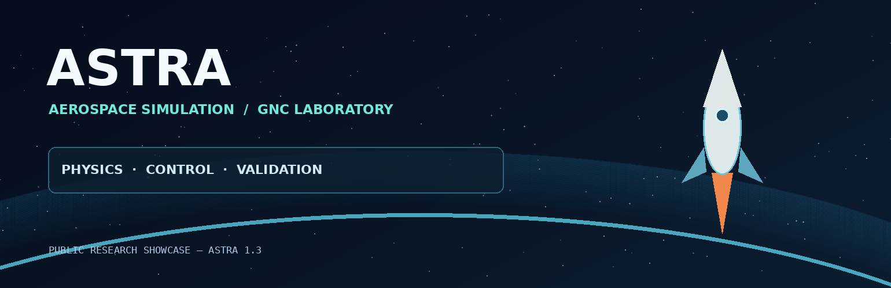
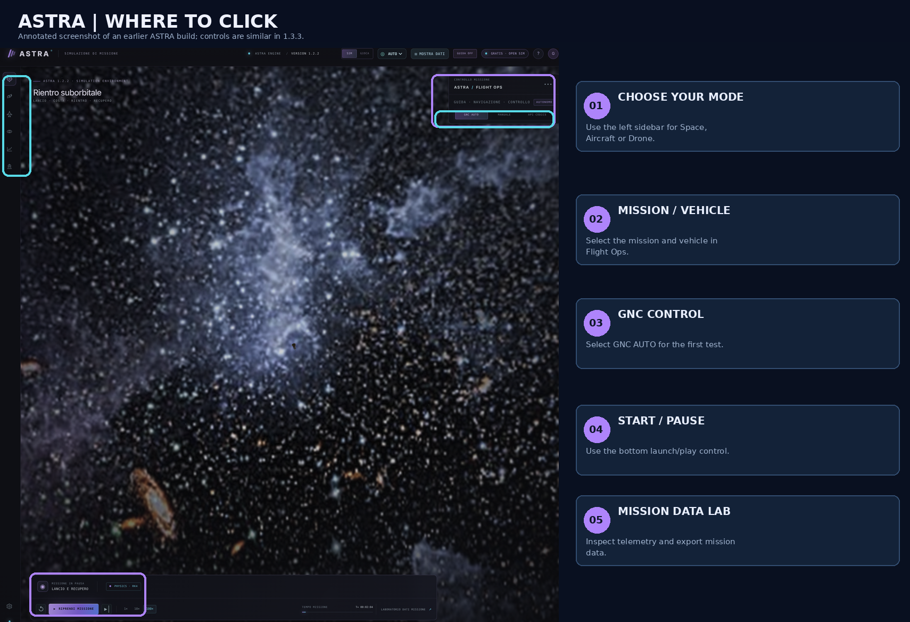
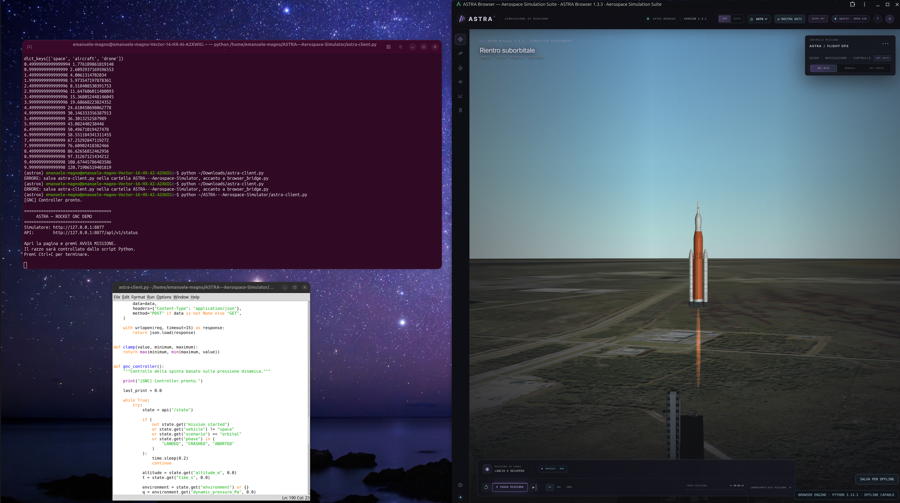
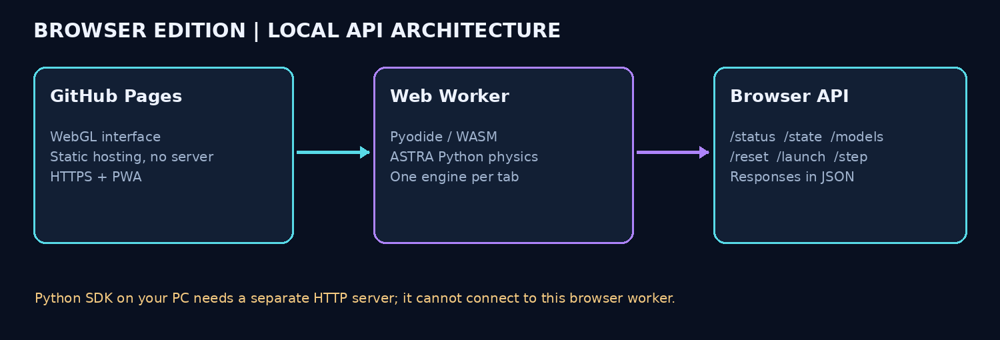
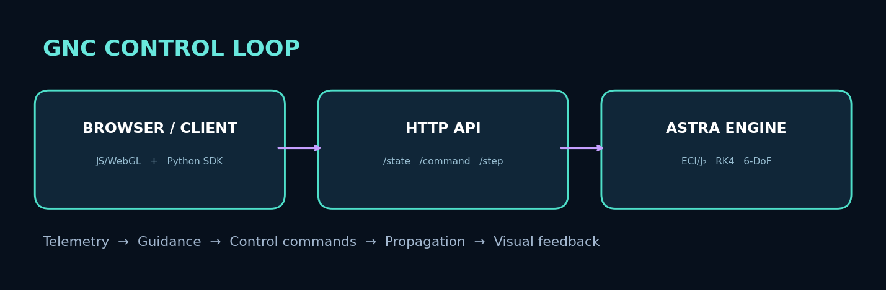
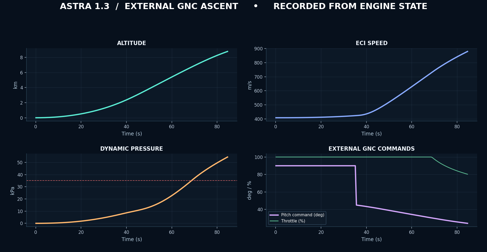

<div align="center">



# ASTRA · Aerospace Simulation Suite

**Spaceflight, atmospheric flight, and autonomous navigation in one interactive simulation environment.**

Run aerospace mission dynamics in the browser with **Python + Pyodide/WebAssembly** and explore the results through a WebGL 3D interface. No payment card, cloud VM, or server-side Python installation is required for the Browser Edition.

[**Launch Simulator**](https://eleman07.github.io/ASTRA---Aerospace-Simulator/) · [**Test the Browser API**](https://eleman07.github.io/ASTRA---Aerospace-Simulator/api-test.html) · [**Engine Diagnostics**](https://eleman07.github.io/ASTRA---Aerospace-Simulator/diagnostics.html) · [**Aerospace Portfolio**](https://elemanprojects.com)

</div>

> **Current published target:** ASTRA Browser 1.3.3, intended for GitHub Pages and installable as a Progressive Web App (PWA). Simulation is computed locally on each device, subject to device CPU/GPU/RAM limits. The browser API is **not** a publicly accessible Python HTTP server.

---

## What can you do?

| Environment | Experience | Examples |
|---|---|---|
| **Space** | Simulate launches, orbital motion, recovery and spacecraft operations | ECI dynamics, gravity/J₂, quaternion attitude, mission guidance and staging |
| **Aircraft** | Explore takeoff, flight performance, stability and landing | Lift/drag models, flight controls, runway operations and atmosphere |
| **Drone** | Study multirotor guidance and flight | Rotors, stabilization, trajectory tracking, wind disturbances |
| **Engineering Studio** | Run standalone engineering analyses | Orbit, propulsion, aerodynamics, thermal, structures, power and link budget |
| **Mission Data Lab** | Inspect and export telemetry | Flight state, mission phases, recorded results |

The simulator is an **engineering education and experimentation platform**, not a certified flight-dynamics tool. Some models are reduced-order and not all standalone Engineering Studio solvers are coupled into live 3D missions. See [Model Readiness](ASTRA-1.3-MODEL-READINESS.md) for the implementation boundaries.

## Quick start — first mission in 5 steps

1. Open **[ASTRA online](https://eleman07.github.io/ASTRA---Aerospace-Simulator/)** using an updated Chrome, Edge, Firefox or Safari browser.
2. Wait until the browser engine finishes loading. The first run downloads the local Python/WebAssembly runtime; **`BROWSER ENGINE · PYTHON …`** confirms the interpreter is ready. If it fails, use [Diagnostics](https://eleman07.github.io/ASTRA---Aerospace-Simulator/diagnostics.html).
3. Select **Space**, **Aircraft**, or **Drone** using the left navigation. In **ASTRA / FLIGHT OPS**, choose the mission and a vehicle model.
4. For your first run, keep **GNC AUTO**. Click **START MISSION / AVVIA MISSIONE** in the bottom transport bar.
5. Watch the 3D scene and telemetry. Use **Pause**, **Step**, or **Reset** to inspect the mission. Open **Mission Data Lab** for traces and export options.



*Annotated screen capture from an earlier ASTRA build. The placement of the main controls remains similar, but exact labels and layout may vary with the current version and screen size.*

### Your first rocket mission

Choose **Space → GNC AUTO → Start Mission**. You should see the mission phase and `time_s` progress; altitude/velocity telemetry will evolve as the rocket follows its profile. If the vehicle does not move, test the Python engine first rather than retrying the same button repeatedly.

### Your first aircraft or drone mission

Choose **Aircraft** or **Drone**, select the vehicle in Flight Ops, keep **GNC AUTO**, and start the mission. Camera and manual controls are available in the flight interface. The first load of a GLB model may take longer on mobile devices.

<details>
<summary><strong>Show aircraft interface example</strong></summary>



*Archived interface example, not a current version 1.3.3 benchmark.*

</details>

## Verify that the engine actually works

**Option A — no code:** use [**ASTRA Browser API Test Console**](https://eleman07.github.io/ASTRA---Aerospace-Simulator/api-test.html) after deploying this documentation kit. The page starts an isolated engine Worker and exposes two real tests:

1. **Test status / models / state** — checks interpreter, catalog and live state.
2. **Run rocket launch API test** — resets a spacecraft, starts the mission and executes 30 simulation steps.

Expected results: **`PASS · READ API`** and **`PASS · ROCKET SIMULATION`**, followed by a JSON report you can download. These checks validate execution and state progression, not the absolute physical accuracy of every model.

**Option B — diagnostics:** use the [Pyodide diagnostics page](https://eleman07.github.io/ASTRA---Aerospace-Simulator/diagnostics.html) and run **Verify files and engine startup**. Look for `PYODIDE READY`.



Read the [**Complete API Testing Guide**](docs/API_TESTING.md) for browser JavaScript examples, original Python HTTP API commands, SDK installation and troubleshooting.


## Demonstration video and telemetry

[

**[Watch the technical ascent demo (MP4)](docs/media/astra-ascent-demo.mp4)** — a 2D visualization generated from an executed ASTRA simulation, **not** a recording of the WebGL scene.

## Aerospace algorithms and GNC

ASTRA includes numerical integration and control/navigation elements such as fourth-order Runge–Kutta propagation, gravity/J₂, quaternion attitude kinematics, feedback guidance and relative-motion models. The specific algorithms depend on the selected vehicle and mission; some have separate design-analysis implementations rather than live coupling.





*The architecture graphic is conceptual; the performance plots come from a sample simulation dataset, not independently certified flight-test data.*

See [Engineering Studio](ENGINEERING-STUDIO.md) and [Model Readiness](ASTRA-1.3-MODEL-READINESS.md) for detailed scope and limitations.

## Python SDK: how to install and test it

The **original ASTRA Python server** has an HTTP/JSON API, accessible from `astra.client`. The SDK **cannot** connect directly to this GitHub Pages site because physics is running inside each visitor's browser Worker, not at a network listening port.

To use the SDK, start the **original complete ASTRA server package** (with `astra/server.py` and `astra/__main__.py`) on your PC:

```bash
python3 -m astra --host 127.0.0.1 --port 8765
```

Install the wheel in your development environment:

```bash
python3 -m venv .venv
source .venv/bin/activate
python -m pip install ./downloads/astra_simulator_client-1.3.0-py3-none-any.whl
python -c 'from astra.client import AstraClient; print("SDK installed")'
```

Test the **original HTTP server** in a second terminal:

```bash
python tools/test_astra_http.py --url http://127.0.0.1:8765
python tools/test_astra_http.py --url http://127.0.0.1:8765 --simulate --steps 30
```

Expected final line: **`ALL TESTS PASSED`**. The second command resets and advances the simulator's shared state; do not run it on a public server with other users.

See [docs/API_TESTING.md](docs/API_TESTING.md) for Windows instructions, a browser-console example, endpoint tables and error explanations.

## Links and project documentation

- [**Live ASTRA Browser**](https://eleman07.github.io/ASTRA---Aerospace-Simulator/)
- [**API Test Console**](https://eleman07.github.io/ASTRA---Aerospace-Simulator/api-test.html)
- [**API Testing Guide**](docs/API_TESTING.md)
- [**Engineering Studio reference**](ENGINEERING-STUDIO.md)
- [**Model readiness and validation boundaries**](ASTRA-1.3-MODEL-READINESS.md)
- [**Italian GitHub Pages/PWA setup guide**](GITHUB-PAGES-TUTORIAL-IT.md)
- [**Personal aerospace portfolio**](https://elemanprojects.com)

---

<div align="center">

**ASTRA — Per aspera ad astra.**

*An open, evolving environment for aerospace learning, simulation and GNC experimentation.*

</div>
